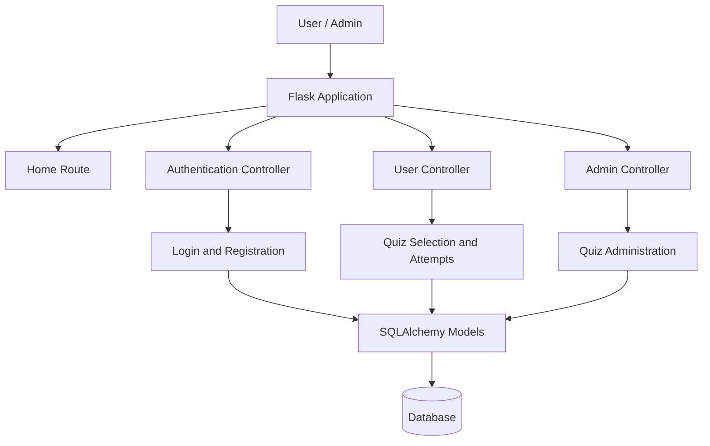

# 🎯 Quiz App — Flask-Based Quiz Management System

A web-based quiz application built with **Flask** that allows users to register, log in, attempt timed quizzes, and track their performance. The application also provides an administrative dashboard for managing quizzes.

The project follows a modular Flask architecture, separating authentication, user functionality, and administrative operations into different controllers.

## ✨ Features

### 👤 User Features

- **User Registration & Login:** Create an account and securely authenticate.
- **Subject-Based Quiz Selection:** Choose quizzes according to subjects and chapters.
- **Timed Quiz Attempts:** Attempt quizzes with a time limit.
- **Score Tracking:** Evaluate quiz performance through recorded scores.

### 🛠️ Admin Features

- **Admin Dashboard:** Access administrative quiz-management functionality.
- **Quiz Management:** Manage quiz-related content through the admin interface.
- **Role Separation:** Keep user-facing functionality separate from administrative operations.

### 🔐 Authentication & Security

- Flask-Login for managing authenticated sessions.
- Flask-Bcrypt for password hashing.
- Flask-WTF and WTForms for form handling and validation.
- Flask-SQLAlchemy for database integration.

## 🧰 Tech Stack

| Technology | Purpose |
|---|---|
| Python | Application logic |
| Flask | Web application framework |
| Flask-SQLAlchemy | Database integration and ORM |
| Flask-Login | User authentication and session management |
| Flask-Bcrypt | Password hashing |
| Flask-WTF | Form handling and CSRF protection support |
| WTForms | Form validation |
| python-dotenv | Environment-variable configuration |
| Werkzeug | Web utilities and request handling |

## 🏗️ Application Architecture

The application uses a modular structure with separate controllers for authentication, user operations, and administrative functionality.



### Request Flow

1. A user accesses the application through the Flask routes.
2. Authentication routes handle registration and login.
3. Flask-Login manages the authenticated user session.
4. User routes handle quiz-related operations.
5. Admin routes handle administrative operations.
6. SQLAlchemy models provide the application's database interface.

## 📂 Project Structure

```text
Quiz-app/
│
├── app/
│   ├── __init__.py
│   ├── models.py
│   ├── controllers/
│   │   ├── auth_controller.py
│   │   ├── user_controller.py
│   │   └── admin_controller.py
│   ├── templates/
│   └── static/
│
├── config/
│   └── commands.py
│
├── main.py
├── requirements.txt
├── .gitignore
└── README.md
```

*Note: The controller paths, `main.py`, `requirements.txt`, and top-level directories are based on the repository. Template, static-file, and model substructure may need adjustment to match the complete current directory tree.*

### Important Components

- **`main.py`** — Creates the Flask application, registers the authentication, user, and admin blueprints, registers custom commands, and defines the home route.
- **`app/__init__.py`** — Application initialization and shared Flask extensions.
- **`app/models.py`** — Database models, including the user model.
- **`app/controllers/auth_controller.py`** — Authentication-related routes.
- **`app/controllers/user_controller.py`** — User-facing functionality.
- **`app/controllers/admin_controller.py`** — Administrative functionality.
- **`config/commands.py`** — Custom Flask command registration.
- **`requirements.txt`** — Python dependencies.

## 🚀 Getting Started

### Prerequisites

Install the following before running the application:

- Python 3.10 or another version compatible with your dependencies
- pip
- Git

### 1. Clone the repository

```bash
git clone https://github.com/shubham2249/Quiz-app.git
cd Quiz-app
```

### 2. Create a virtual environment

**Linux / macOS / WSL**

```bash
python -m venv .venv
source .venv/bin/activate
```

**Windows PowerShell**

```powershell
python -m venv .venv
.venv\Scripts\Activate.ps1
```

### 3. Install dependencies

```bash
python -m pip install --upgrade pip
pip install -r requirements.txt
```

### 4. Configure environment variables

If the application uses environment variables, create a `.env` file with the settings required by your configuration.

For example:

```env
SECRET_KEY=replace-with-a-secure-random-secret
```

Configure any database settings required by the project. Check the application's configuration before adding variables such as a database URI; their exact names and defaults depend on the implementation.

**Security:** Never commit real credentials, secret keys, or production environment files to GitHub.

### 5. Run the application

Start the Flask application from the project root:

```bash
python main.py
```

Open the local address displayed in the terminal, typically:

`http://127.0.0.1:5000/`

The application entry point currently enables Flask debug mode for local development. Disable debug mode before deploying to production.

## 🧑‍💻 How to Use

### For users

1. Open the application in your browser.
2. Register a new account or log in.
3. Select a subject and chapter.
4. Start a quiz and answer the questions within the allotted time.
5. Complete the quiz and review the resulting score, where supported by the application.

### For administrators

1. Log in using an authorized administrative account.
2. Open the admin dashboard.
3. Access the available quiz-management functionality.
4. Manage quiz content according to the permissions implemented in the application.

Administrative account creation and initial database setup depend on the project's configuration and custom commands.

## 🔐 Security Considerations

The project uses Flask-Bcrypt and Flask-Login as part of its authentication stack. For reliable deployment, consider the following:

- Store passwords as hashes rather than plaintext.
- Keep secret keys and credentials outside source control.
- Ensure administrative routes enforce authorization checks.
- Enable and validate CSRF protection on applicable forms.
- Use production-safe cookie and session settings.
- Disable debug mode in production.
- Validate submitted data on the server.
- Use a production WSGI server when deploying.

## 🧪 Testing

If automated tests are available in the repository, run them using the configured test framework. For a project using pytest:

```bash
python -m pip install pytest
python -m pytest
```

Manual smoke testing should cover registration, login, quiz selection, timed quiz submission, score handling, and administrative access.

## 🗺️ Future Improvements

Potential enhancements include:

- [ ] Add detailed performance analytics and quiz history.
- [ ] Support configurable difficulty levels.
- [ ] Add question randomization and shuffled options.
- [ ] Improve validation and error handling.
- [ ] Add comprehensive unit and integration tests.
- [ ] Add pagination and search for quiz management.
- [ ] Introduce database migrations.
- [ ] Add Docker-based deployment and continuous integration.

## 🎓 Learning Outcomes

This project demonstrates practical experience with:

- Flask application factories and blueprints.
- Authentication and session management.
- Relational database integration using an ORM.
- Password hashing and web form validation.
- Role-based separation of application functionality.
- Organizing a Python web application into reusable modules.

## 🤝 Contributing

Contributions and suggestions are welcome.

1. Fork the repository.
2. Create a feature branch.
3. Implement and test your changes.
4. Commit your changes with a descriptive message.
5. Open a pull request.

## 📄 License

No license has been confirmed. Add a `LICENSE` file if you intend to distribute the project under an open-source license.

## 👨‍💻 Author

**Shubham**

- GitHub: [@shubham2249](https://github.com/shubham2249)
- Repository: [Quiz-app](https://github.com/shubham2249/Quiz-app)

---

If you find this project useful, consider giving the repository a ⭐.
